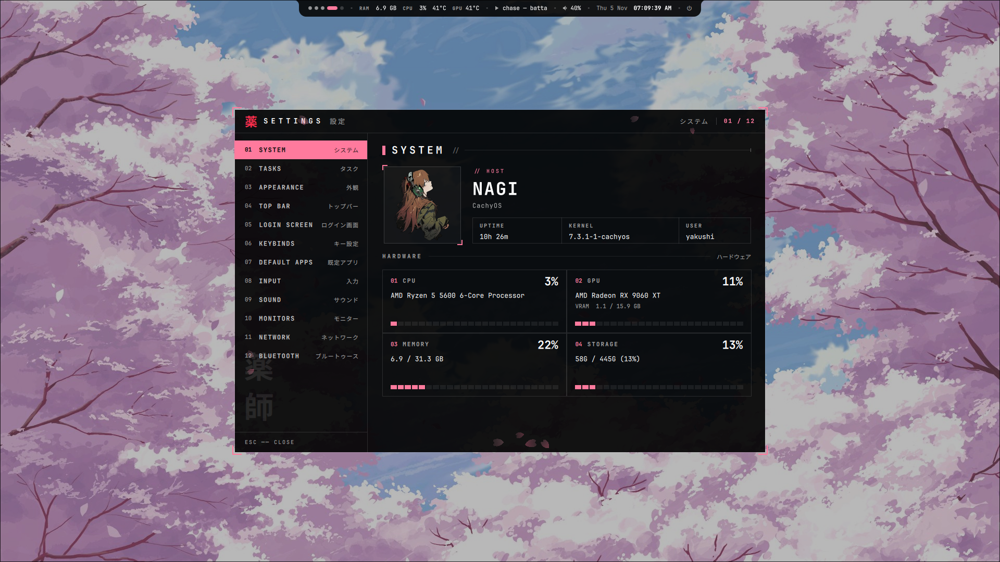

# 薬 Dotfiles

A light Hyprland desktop built around one **Settings** panel and an island top bar.
Official Arch repositories only, no AUR, and nothing runs in the background unless it is needed.

<p align="center">
  
</p>

## Features

- **Settings** (`SUPER + I`) — accent colours, window gaps / corners / shadow / border, top
  bar, login screen, keybinds, default apps, input, sound, monitors, network, Bluetooth,
  tasks and security. Every change applies instantly.
  Move it by its title strip or with `SUPER + left drag`, resize it by its edges or with
  `SUPER + right drag`; it always opens at its default size in the middle.
- **Island top bar** — workspaces, RAM, CPU, temperatures, now playing (with a drop-down player
  and visualizer), volume, date, time and a power menu. Modules can be toggled and reordered.
  A plain **Waybar** style in the same look is one click away.
- **One accent everywhere** — bar, power menu, window borders, lock screen and terminal colours
  (kitty, alacritty, foot, ghostty, fish) follow the chosen accent.
- **Light or dark apps** — one switch in Appearance turns GTK 3, GTK 4 / libadwaita apps
  (Files, Firefox…) light or dark.
- **Cursor picker** — Input lists every installed cursor theme with a preview, sets the size
  and can grow the cursor when you shake the mouse. Our own cursor, Yakushi Red, comes
  with it, white edged or black edged (Yakushi Red Dark).
- **Tasks** (`SUPER + Esc`) — what runs on your computer, live: CPU, memory and every process,
  and for each one, in plain words, why it runs — which package it comes from, whether you
  installed that package or which program brought it in, and who started it (a service,
  Hyprland at login, a shortcut, D-Bus). Apps that stop answering are flagged (NOT
  RESPONDING, STUCK, PAUSED) and can be ended right there: END asks politely, FORCE END
  stops them at once, services can be stopped. **REMOVE A PACKAGE** takes a program off
  without a trace: it shows first what goes (the package, dependencies nothing else needs,
  its services, its files in your home folder), asks for your password right in the page
  (it goes to sudo through a pipe and is not kept), and keeps your
  files in a trash so **UNDO** can put everything back. The base system, kernels and what
  Yakushi runs on are protected.
  If the bar or Settings ever freezes,
  `SUPER + CTRL + Esc` restarts them without touching your windows.
- **Security** — nothing runs in the background for it. The page shows the firewall
  (ufw: everything coming in is blocked, going out is allowed), what listens to your network,
  the SSH server, waiting updates and the ones that fix known security holes (arch-audit),
  auto lock (hypridle), disk encryption and Secure Boot, each with its fix one click away.
  **UPDATE** runs `pacman -Syu` right in the page with its progress (your password is asked
  there); pacman runs on its own, so closing Settings never stops it halfway. Nothing ever
  updates by itself. A **guard** checks once at login what changed in the places an intruder
  would use to stay (what starts at login, services and timers, users and the wheel group,
  SSH keys, shell start files, `/etc/ld.so.preload`, open ports) and lists failed passwords,
  sudo use and SSH logins; only serious news shows as a Hyprland notification. **DEEP SCAN**
  compares every system program and library with its package.
- **Network** — Ethernet and Wi-Fi in one page: the connection in use with its live traffic,
  a speed test (with the average of the last tests), and per connection DNS (automatic,
  Cloudflare, Google, Quad9, AdGuard or your own), automatic or manual IP and auto-connect.
- **Bluetooth** — connected devices, your paired devices and the ones nearby in separate
  groups, with battery level, auto-connect and forget.
- **Default apps** — scans what is installed and sets the terminal, shell, file manager,
  browser, editor and viewers.
- **Wallpaper picker** (`SUPER + W`) — every image under `~/Documents`, applied with `awww`.

## Light and careful

- **Almost nothing stays running.** The bar reads a few kernel files every 2 seconds and
  is otherwise event driven; Settings, the volume pill and the wallpaper picker are separate
  processes that quit when closed. hyprsunset runs only while night light is on, hypridle
  only while auto lock is on, cava only while the visualizer is on screen.
- **Passwords never leave the page.** Whenever something needs root (removing a package,
  the system update, the firewall, the login screen background, the login shell), Settings
  asks for your password itself and hands it to sudo through a pipe. Wi-Fi passwords reach
  NetworkManager the same way: never on a command line, where other programs could read them.
- **Untrusted text stays text.** Network and Bluetooth names, song titles, process names and
  log lines are always shown as plain text, so none of them can load anything from the
  internet or change how a page looks.
- **Config files are written safely.** On a full disk a change is refused and your
  `hyprland.lua`, keybinds and the rest stay whole.
- **Suspend locks the screen first**, so the computer never wakes up unlocked.

## Install

```fish
git clone https://github.com/KayamiYakushi/yakushidotfiles.git
cd yakushidotfiles
sh install.sh
```

The installer installs the packages from the official repositories, backs up your current
configs to `~/YakushiBackups/`, installs the desktop and the SDDM theme, and detects your
keyboard layout. If another login manager is enabled, it is left alone.

## Shortcuts

| Shortcut | Action |
| --- | --- |
| `SUPER + I` | Settings |
| `SUPER + SPACE` | App launcher |
| `SUPER + Q` / `E` / `B` | Terminal / file manager / browser |
| `SUPER + C` | Close window |
| `SUPER + V` | Clipboard history |
| `SUPER + SHIFT + S` | Area screenshot to clipboard |
| `SUPER + W` | Wallpaper picker |
| `SUPER + TAB` | Lock screen |
| ``SUPER + ` `` | Power menu |
| `SUPER + SHIFT + W` | Show / hide the bar |

All of them can be changed in Settings → Keybinds.

## License

MIT — see [`LICENSE`](LICENSE).
